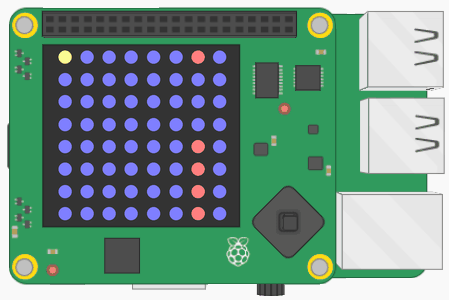

## What you will make
In this activity you will create a Flappy Bird clone using your Raspberry Pi, a Sense HAT, and some Python code. In your Flappy Astronaut game the player uses the Sense HAT joystick to navigate an astronaut around pipes.

## What you will learn
By making a Flappy Astronaut game with your Raspberry Pi and Sense HAT, you will learn how to:

- Light up Sense HAT LEDs
- Use the Sense HAT joystick
- Use 2D lists to represent a screen

Here's the game in action. The astronaut is the yellow pixel, and the player steers it with the joystick to fly through the gaps in the pipes.

This resource covers elements from the following strands of the [Raspberry Pi Digital Making Curriculum](https://www.raspberrypi.org/curriculum/):

- [Apply abstraction and decomposition to solve more complex problems](https://www.raspberrypi.org/curriculum/programming/developer)
- [Use basic digital, analogue, and electromechanical components](https://www.raspberrypi.org/curriculum/physical-computing/creator)
